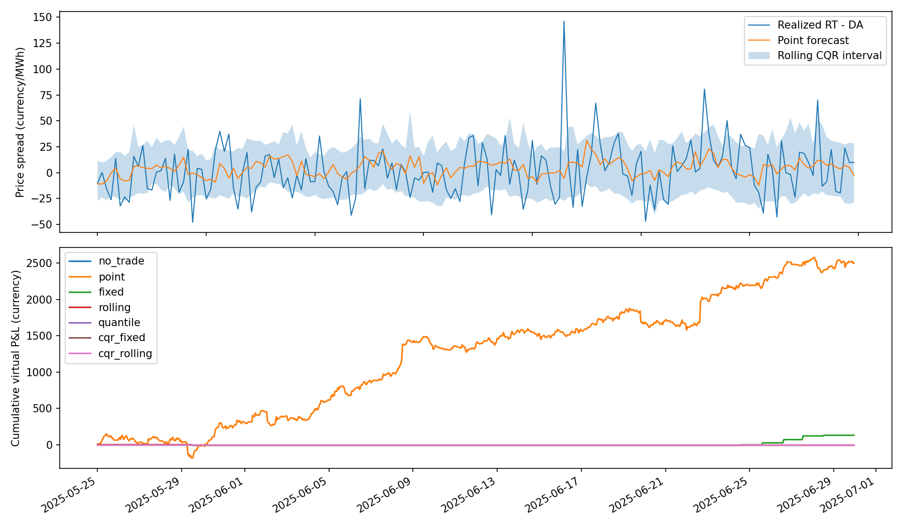

# Electricity Price Forecasting with Conformal Prediction

面向电力市场预测与交易算法实习的简要研究项目：使用梯度提升树预测日前电价、实时电价和两者价差，再用 Conformal Prediction 构建预测区间，并分析区间如何影响交易决策。

**定位：基于《Conformal Prediction for Electricity Price Forecasting in the Day-Ahead and Real-Time Balancing Market》这一论文主题的教学实现。** 尚未取得论文正文、作者代码及原始数据，不能称为论文原始实验的精确复现，也不宣称下面的模型、划分和结果来自原文。确认论文版本后，应逐项核对数据市场、结算定义、预测时点、模型、校准方法与评价指标。所有代码注释和 docstrings 使用英文。

## 1. 研究问题和个人理解

电价预测不能只看平均误差。实时市场会受负荷偏差、可再生能源出力偏差和机组故障影响，价格可能出现尖峰；一个点预测不能表达这些风险。Conformal Prediction 的作用是利用历史预测残差，为模型增加一个可校准的误差区间。

例如，同样预测价格为 100，区间为 [90, 110] 与 [20, 180] 对决策的意义不同。区间宽度是风险信息，但它不是对单笔交易的盈利保证；90% 的边际覆盖率也不是“每一个小时都有 90% 的条件覆盖率”。

我把研究分成两个问题：

- **预测侧：** 在数据分布发生变化后，固定校准区间是否失效？滚动校准能否改善覆盖率，代价是否是更宽的区间？
- **交易侧：** 当预测价差的整个区间都超过成本时才交易，能否减少不确定头寸？减少交易次数是否也会损失收益机会？

## 2. 方法

### 点预测与时间划分

采用 `HistGradientBoostingRegressor`，分别训练日前价格、实时价格和 `spread = price_rt - price_da` 三个模型。按完整 UTC 日期约 60% / 20% / 20% 划分训练、校准、测试集，禁止随机打乱。模型只在训练集拟合，测试阶段不重新训练。

输入包含小时周期特征、星期、负荷预测、风电预测、日前与实时电价的 48 小时滞后值。选择较保守的 48 小时滞后，是为了减少日前预测使用未来信息的风险；真实市场仍需按 gate closure 和价格发布时间核对。数据标准化、调参、特征选择也必须避免使用测试标签，本项目未使用这些步骤。

### Split Conformal

校准集中的非一致性分数是绝对残差：

$$s_i = |y_i - \hat f(x_i)|.$$

给定误覆盖率 $\alpha$，令 $k=\lceil(n+1)(1-\alpha)\rceil$，取第 $k$ 小的分数 $q$，输出：

$$C(x)=[\hat f(x)-q,\ \hat f(x)+q].$$

当 $k>n$ 时返回无限半径，保留有限样本定义，而不是人为截断分位数。默认 $\alpha=0.1$，即目标覆盖率 90%。在交换性条件成立时，该方法有有限样本边际覆盖保证。电价时间序列存在自相关和漂移，因此本实验仅通过样本外覆盖率评价，**不声称严格保证在该序列上成立**。

首先比较两种绝对残差校准：

| 方法 | 校准方式 | 特点 |
|---|---|---|
| Fixed | 整个校准集残差，测试期保持不变 | 简单，但可能无法适应分布变化 |
| Rolling | 最近 336 小时残差，每天更新一次 | 可以适应近期波动，也可能滞后、变宽 |

新增三组分位数方法：`quantile` 是不加校准的上下分位数回归基线；`cqr_fixed` 与 `cqr_rolling` 分别做固定和滚动校准。上下界模型只在训练集拟合，分位点为 $\alpha/2$ 和 $1-\alpha/2$；若分位数交叉，先排序后再计算校准分数。点预测 MAE 始终使用同一个均值回归模型，避免把区间方法变化误写成点预测改进。

采用 expansion-only CQR 分数：

$$s_i=\max\{\hat q_L(x_i)-y_i,\ y_i-\hat q_U(x_i),\ 0\}.$$

用相同的有限样本分位数得到修正量 $q$，区间为 $[\hat q_L(x)-q,\hat q_U(x)+q]$。与允许负分数的标准 signed CQR 相比，该版本只扩大基础区间，不收缩，可能更保守；这是本项目的独立设计，不声称来自目标论文。滚动更新使用**原始分位数区间**的分数，不能误用已经扩张后的区间来计算下一次分数。

每天先生成当天全部区间，待当天标签实现后才更新下一天的残差窗口。同一天内的标签不会影响当天区间。这里假设上一天的结算价格在下一次预测前可获得；若真实市场公布更晚，需要延迟更新。滚动区间不是自适应覆盖率算法的完整实现，也没有自动恢复交换性保证。

### 评价指标

- **MAE：** 衡量点预测误差。
- **Coverage：** 测试价格落在区间内的比例。
- **Mean width：** 平均区间宽度，必须结合覆盖率看。
- **Interval score：** 区间宽度加上未覆盖的惩罚，越小越好：

$$IS_\alpha=(U-L)+\frac{2}{\alpha}(L-y)_++\frac{2}{\alpha}(y-U)_+.$$

## 3. 简化交易规则

**直接预测并校准价差**，不把两个单独价格区间相减后当作同覆盖率的价差区间。

设价差区间为 $[L,U]$，每 MWh 完整交易成本为 $c$：

- 当 $L>c$：持有 +1 MWh 价差头寸，经济含义为日前买入、实时卖出。
- 当 $U<-c$：持有 -1 MWh 价差头寸。
- 其他情况：不交易。

每个交割小时结算收益为 $\pi_t=a_t(P_{RT,t}-P_{DA,t})-c|a_t|$。对比不交易、仅点预测、固定区间、滚动区间及三种分位数区间策略；输出累计收益、成交小时数、每笔平均收益和最大回撤。各小时头寸独立，最大回撤从初始零收益开始计算，没有年化 Sharpe 等不稳健统计。

这是**虚拟价差结算演示**，并不是可直接实盘的交易策略。它假设可按结算价完成两端交易且没有滑点、资金、保证金和流动性约束。真实平衡市场可能要求有物理资产、调度资格或按偏差结算，不能把实时平衡价格普遍视为自由可交易的现货价格。

## 4. 快速运行

建议 Python 3.12。依赖版本记录在 `requirements.txt`。

```bash
python3 -m venv .venv
source .venv/bin/activate
python -m pip install -r requirements.txt

# Optional writable cache locations for restricted cloud environments.
export MPLCONFIGDIR=/tmp/automatic-spoon-mpl
export XDG_CACHE_HOME=/tmp/automatic-spoon-cache
export OMP_NUM_THREADS=2
export OPENBLAS_NUM_THREADS=2

python -m unittest discover -s tests -v
python experiment.py --output outputs/demo
```

默认生成 180 天小时级模拟数据，随机种子 42。测试段人为提高价格噪声幅度，用来展示分布漂移；这不是来自真实市场的数据，也不是具有真实性验证的电力系统模拟器。生成器使用的负荷、风电预测只是合成协变量，不能据此声称具有实际预测能力。

运行后生成：

```text
outputs/demo/
  metrics.csv           # Forecast and interval metrics
  trading_summary.csv   # Aggregate virtual trading results
  predictions.csv       # Hourly point forecasts and interval bounds
  trades.csv            # Hourly positions and realized P&L
  run.json              # Evaluation dates, split sizes and parameters
  results.png           # Spread intervals and cumulative virtual P&L
```

其他参数：

```bash
python experiment.py --alpha 0.1 --window 336 --cost 2 --days 180 --seed 42
python experiment.py --csv /path/to/electricity.csv --output outputs/real
```

`--cost` 的单位是货币/MWh，表示一笔 1 MWh 头寸的全部交易成本，不是每一条交易腿各收一次。测试期间不要反复调成本、窗口或阈值后选择最好结果；参数应在训练/验证阶段确定。

## 5. 真实数据格式与时点约束

CSV 最小字段：

```csv
timestamp,load_forecast,wind_forecast,price_da,price_rt
2025-01-01T00:00:00Z,50.0,18.0,85.0,92.0
2025-01-01T01:00:00Z,49.0,19.0,82.0,80.0
```

上述两行仅展示格式，程序需要至少约 30 天小时数据。`timestamp` 是交割小时，统一为 UTC；价格单位需一致，负价格可保留。程序拒绝重复时间、小时缺口和非有限数值，不会把缺失结算价格用未来值填补。夏令时应先正确转换为 UTC。若实时市场为 15 分钟结算，应先根据市场规则构造与日前价格可比较的小时价格。

**所有特征必须是预测时点已经发布的版本。** `load_forecast` 和 `wind_forecast` 应是日前截止时点之前可获得的预测快照，不能用实际负荷、实际出力或事后修订预测替代。本项目 CSV 接口不包含版本发布时间，因而无法自动证明这一条件；必须由数据整理过程保证。实时价格的滞后值也须在当时已公开。若要研究临近实时的预测，需要重新定义信息集与交易时点，不能混用两种任务。

## 6. 本次实际运行结果

180 天合成数据经滞后处理后，训练 2,544 行、校准 864 行、测试 864 行。以下为本仓库默认命令实际输出，数值保留三位：

| 目标 | 方法 | MAE | 覆盖率 | 平均宽度 | Interval score |
|---|---|---:|---:|---:|---:|
| price_da | fixed | 6.963 | 69.10% | 17.357 | 48.176 |
| price_da | rolling | 6.963 | 86.34% | 27.238 | 38.001 |
| price_da | quantile | 6.963 | 62.38% | 14.969 | 55.568 |
| price_da | cqr_fixed | 6.963 | 70.72% | 18.420 | 47.360 |
| price_da | cqr_rolling | 6.963 | 86.81% | 27.348 | 38.112 |
| price_rt | fixed | 20.583 | 68.75% | 49.982 | 154.253 |
| price_rt | rolling | 20.583 | 86.34% | 79.124 | 128.595 |
| price_rt | quantile | 20.583 | 58.22% | 39.636 | 181.788 |
| price_rt | cqr_fixed | 20.583 | 69.56% | 50.208 | 154.119 |
| price_rt | cqr_rolling | 20.583 | 86.69% | 78.183 | 128.804 |
| spread | fixed | 19.552 | 65.74% | 43.842 | 150.913 |
| spread | rolling | 19.552 | 86.23% | 72.445 | 121.248 |
| spread | quantile | 19.552 | 56.48% | 36.841 | 172.459 |
| spread | cqr_fixed | 19.552 | 65.51% | 43.591 | 153.031 |
| spread | cqr_rolling | 19.552 | 86.34% | 72.573 | 122.990 |

| 策略 | 成交小时数 | 累计虚拟收益 | 最大回撤 |
|---|---:|---:|---:|
| no_trade | 0 | 0.000 | 0.000 |
| point | 686 | 2498.623 | 336.095 |
| fixed | 6 | 130.597 | 6.185 |
| rolling | 1 | -6.185 | 6.185 |
| quantile | 0 | 0.000 | 0.000 |
| cqr_fixed | 0 | 0.000 | 0.000 |
| cqr_rolling | 0 | 0.000 | 0.000 |

结果文件见 [预测指标](reports/demo_metrics.csv) 与 [交易统计](reports/demo_trading_summary.csv)。



**我的解读：** 人为噪声漂移使固定区间明显欠覆盖；滚动校准改善覆盖率和 interval score，但依然没有达到目标 90%，不能写成“覆盖保证已验证”。更宽的区间也大幅减少交易，在本次演示中只产生一笔亏损交易。新增 rolling CQR 的价差覆盖率约为 86.34%，同样未达到 90%；三种分位数区间交易策略均未开仓。因此，区间预测有助于表达风险，但不能推出盈利更高。这也是保留不理想结果而不事后调整阈值的原因。模拟收益不证明真实市场存在套利，更不能代表论文结果。

## 7. 可继续改进的方向

1. 使用论文原始市场、时间跨度和预测发布时点，并加入季节性简单基线；明确验证集调参与最终测试集的边界。
2. 对已实现的 CQR 尝试不同分位数模型与预先确定的窗口，并对比 signed CQR；基础分位数区间可以随特征变化，滚动修正量在同一天相同。
3. 检查峰谷时段、价格尖峰与月份的分组覆盖率；尝试具有明确更新规则的 adaptive conformal 方法。
4. 加入真实偏差结算、仓位限制、滑点、保证金和资产约束，使用多段走步回测并估计收益不确定性。

## 8. 文件说明与参考

- `experiment.py`：模拟数据、时间划分、模型、固定/滚动残差校准、分位数回归、固定/滚动 CQR、交易回测及图表。
- `tests/test_experiment.py`：有限样本分位数、日内信息泄漏、滞后特征与时间缺口、头寸方向与成本核算，以及 CQR 分数和更新逻辑测试。
- `reports/`：本次模拟演示的实测摘要与图。

方法参考：Angelopoulos & Bates, *A Gentle Introduction to Conformal Prediction and Distribution-Free Uncertainty Quantification*, https://arxiv.org/abs/2107.07511 。该文作为通用方法背景，不是上述电力论文的替代来源。目标电力论文的作者、年份、DOI 和具体实验设置待获得正文后补充，避免编造引用。

CQR 方法背景：Romano, Patterson & Candès, *Conformalized Quantile Regression*, https://arxiv.org/abs/1905.03222 。本实现为上述只扩张的变体，非该论文官方代码。
